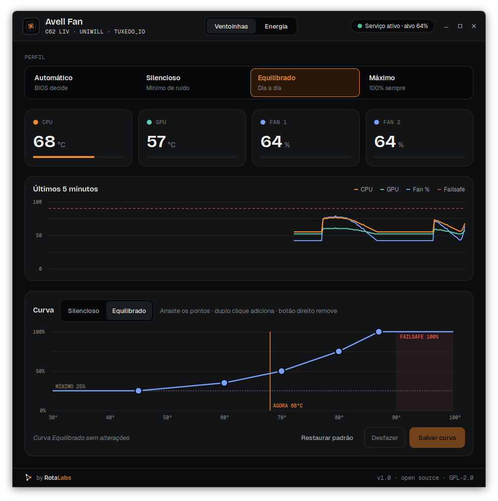
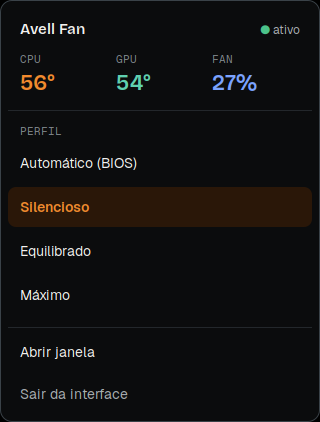
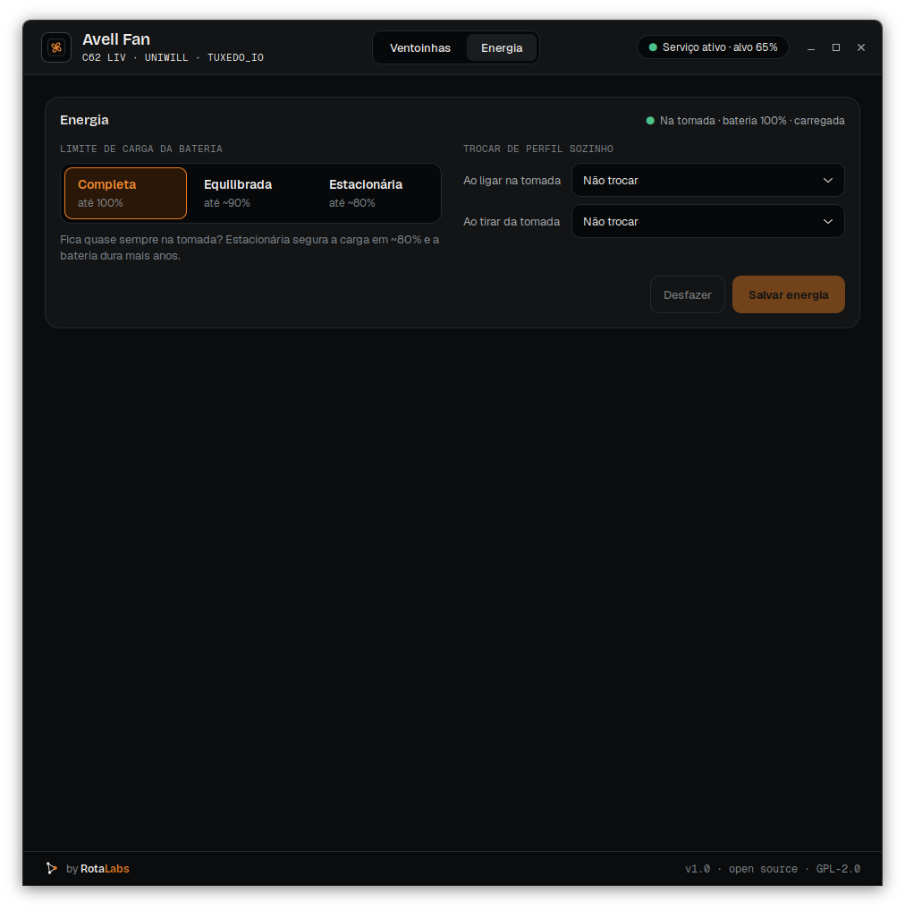
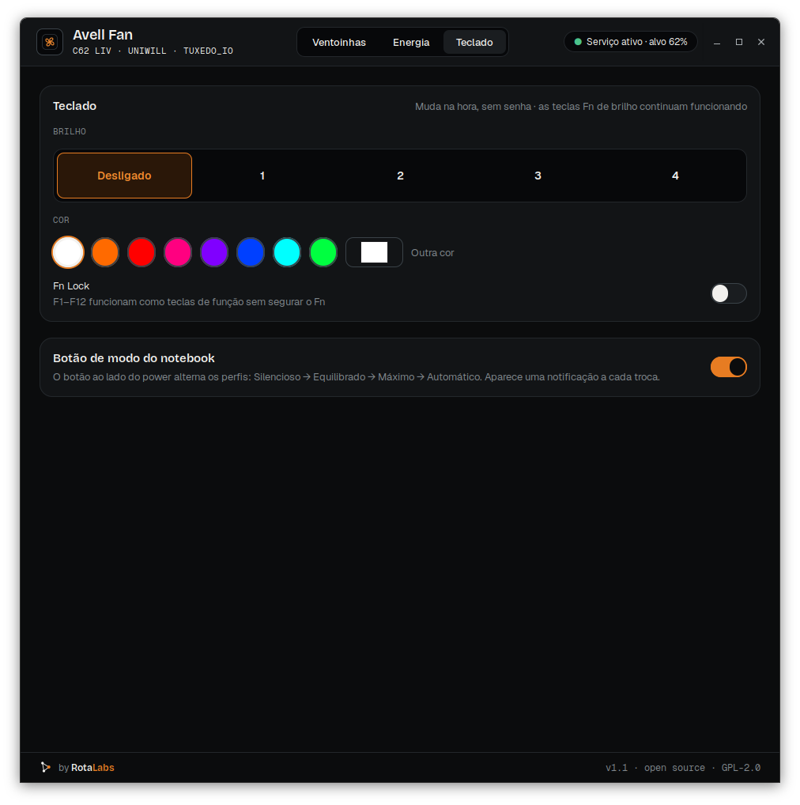

# Avell Fan: controle das ventoinhas do notebook Avell no Linux

[](https://github.com/rotalabsco/avell-fan/releases/latest) [](https://github.com/rotalabsco/avell-fan/actions/workflows/ci.yml) [](LICENSE)

**[Página do projeto](https://rotalabs.co/br/labs/avell-fan)** · **[Baixar o .deb](https://github.com/rotalabsco/avell-fan/releases/latest/download/avell-fan_all.deb)** · um projeto [Rota.Labs](https://rotalabs.co/br/labs)

Controle das ventoinhas (fans/coolers), da bateria e do teclado RGB de notebooks **Avell** no **Linux** (Ubuntu, Linux Mint e derivados). Tem perfis prontos, curva editável e ícone na bandeja. Funciona em notebooks com chassi **Uniwill / Tongfang**, onde o botão de fan e o Control Center só existem no Windows.


<sub>Captura com dados de exemplo.</sub>

## Por que existe

O botão de ventoinha dos notebooks Avell não faz nada no Linux. No Windows, ele só avisa o *Control Center* da fabricante (Uniwill), e esse programa não existe para Linux. Sem ele, o notebook fica preso na curva automática da BIOS.

O Avell Fan troca o Control Center por um serviço com interface própria:

- **4 perfis:** Automático (BIOS), Silencioso, Equilibrado e Máximo;
- **curvas editáveis:** você arrasta os pontos de temperatura × velocidade;
- **temperaturas da CPU e da GPU e rotação dos dois fans**, com gráfico dos últimos 5 minutos;
- **limite de carga da bateria** (100 %, ~90 % ou ~80 %): para quem vive na tomada, a bateria dura mais anos;
- **troca de perfil automática** ao ligar ou tirar da tomada (ex.: silencioso na bateria);
- **brilho e cor do teclado RGB** e **Fn Lock**, sem senha;
- **botão de modo** (ao lado do power) alternando os perfis, com a **luz do botão** acompanhando o perfil, como no Windows;
- **ícone na bandeja** para trocar de perfil com um clique;
- **comando de terminal** (`avell-fan`) para scripts.



| Energia | Teclado |
|---|---|
|  |  |

## Compatibilidade

| Modelo | Status |
|---|---|
| Avell C62 LIV (i7‑10750H, RTX 2060) | ✅ testado: fans, perfis, limite de carga, botão de modo e luz do botão |
| Outros Avell com BIOS Uniwill | ❓ provável, não testado |
| Outros notebooks com chassi Uniwill/Tongfang | ❓ provável, não testado |

Para saber se o seu notebook é Uniwill, rode:

```bash
sudo dmesg | grep -i "UNIWILL"
```

Se aparecer `UNIWILL Tech BIOS`, o seu notebook é Uniwill. Rode então o diagnóstico abaixo, que não instala nada. Funcionou (ou não) em outro modelo? Abra uma [issue](https://github.com/rotalabsco/avell-fan/issues) com o modelo e a saída do `testar.sh`.

## Instalação

Requisitos: Ubuntu 22.04+ / Linux Mint 21+ (ou derivados), kernel 6.x ou 7.x e **Secure Boot desligado**. Com Secure Boot ligado, os módulos precisam ser assinados com MOK.

### Pelo pacote .deb (mais fácil)

Baixe o [`avell-fan_all.deb`](https://github.com/rotalabsco/avell-fan/releases/latest/download/avell-fan_all.deb) (sempre a última versão; todas estão em [Releases](https://github.com/rotalabsco/avell-fan/releases)) e instale:

```bash
sudo apt install ./avell-fan_all.deb
```

O pacote compila os drivers (DKMS), liga o serviço e põe o **Avell Fan** no menu. Se você já tinha instalado pelo `instalar.sh`, o pacote remove a instalação antiga sozinho. Para remover: `sudo apt remove avell-fan`.

### Pelo código-fonte

```bash
git clone https://github.com/rotalabsco/avell-fan.git
cd avell-fan

# 1. Diagnóstico: só leitura, nada é instalado e os drivers somem no reboot
sudo ./testar.sh

# 2. Teste de escrita: fans a 100% por 10 s, depois voltam ao automático
sudo ./avell-fan testar 100 10

# 3. Instalação completa: drivers (DKMS), serviço, interface e bandeja
sudo ./instalar.sh
```

Depois de instalar, abra **Avell Fan** no menu de aplicativos. O ícone da bandeja inicia sozinho a cada login: clique esquerdo abre o painel rápido, clique direito abre a janela. Fechar a janela deixa o programa na bandeja.

> Salvar curvas, energia e o botão pede a senha de administrador numa janela do sistema. Essa janela só aparece com o app aberto **pelo menu**. Aberto pelo terminal, o Linux não mostra o pedido, e a interface avisa isso.

Para remover: `sudo ./desinstalar.sh`.

## Personalizar a aparência

A interface segue o **RotaLabs DS**, mas cores, fontes e cantos vêm de um arquivo JSON. Já vêm dois temas, escuro e claro, e você pode criar o seu declarando só o que muda:

```bash
avell-fan-gui --tema rotalabs-claro
```

Guia completo, com a tabela de tokens e um JSON Schema para o editor: [docs/TEMA.md](docs/TEMA.md).

## Uso pelo terminal

```bash
avell-fan status                 # temperaturas, velocidades e perfil
avell-fan perfil silencioso      # auto | silencioso | equilibrado | maximo
avell-fan proximo                # alterna para o próximo perfil
avell-fan carga                  # mostra o limite de carga da bateria
sudo avell-fan carga stationary  # high_capacity (~100%) | balanced (~90%) | stationary (~80%)
avell-fan teclado 4 '#ff6a00'    # brilho 0-4 e cor do teclado (sem senha)
```

Trocar de perfil não pede senha. Salvar curvas novas pede a senha de administrador uma vez.

## Segurança

Mexer no controlador do notebook (EC) exige cuidado. O Avell Fan foi feito para falhar do lado seguro:

- **Failsafe:** a partir de 90 °C os fans vão a 100 %, qualquer que seja o perfil.
- **Mínimo de 25 %** no modo manual: o fan nunca para por engano.
- **Se o serviço fechar, travar ou for morto,** o controle volta para a BIOS. Isso é garantido pelo `ExecStopPost` e pelo watchdog do systemd.
- **Recuperação:** se o modo manual cair, por exemplo depois de suspender o notebook, o serviço percebe e reaplica.
- **Validação:** as curvas são validadas antes de salvar. A velocidade nunca diminui quando a temperatura sobe.

## Como funciona

```
Interface (GTK3, usuário) ─┐
                           ├─▶ /run/avell-fan ─▶ serviço avell-fan (root) ─ioctl─▶ /dev/tuxedo_io ─WMI─▶ EC Uniwill ─▶ fans
Terminal (avell-fan)    ───┘
```

O acesso ao hardware usa os módulos `tuxedo_io`, `uniwill_wmi` e `tuxedo_keyboard` do projeto [tuxedo-drivers](https://github.com/tuxedocomputers/tuxedo-drivers). A TUXEDO usa o mesmo chassi Uniwill em vários modelos. Os módulos vão em `vendor/` e são compilados via DKMS, então se recompilam sozinhos a cada kernel novo. Registradores, caminhos do driver e decisões de projeto estão em [docs/TECNICO.md](docs/TECNICO.md).

> Não instale junto o `tuxedo-drivers` nem o TUXEDO Control Center pelo apt: os módulos têm os mesmos nomes e entram em conflito.

## Roadmap

- [x] Limite de carga da bateria e perfil automático na tomada/bateria
- [x] Botão de modo alternando os perfis (confirmar em mais modelos)
- [x] Brilho e cor do teclado RGB, Fn Lock
- [x] CI compilando os drivers contra kernels novos
- [x] Pacote `.deb`
- [ ] Testar em outros modelos Avell
- [x] Tema claro e temas personalizáveis ([docs/TEMA.md](docs/TEMA.md))

## English

**Avell Fan** is a fan control app for **Avell laptops on Linux** (Uniwill/Tongfang chassis). It is a replacement for the Windows-only Control Center. It provides a themeable GTK3 window (JSON design tokens, dark and light themes included) and a tray panel, fan profiles (BIOS auto, silent, balanced, max), editable temperature curves, CPU/GPU temperature monitoring, a battery charge limit (100/90/80 %) automatic profile switching on AC/battery, RGB keyboard brightness/color, Fn Lock and the mode button next to the power key. Install with the `.deb` from Releases. It also has a systemd service with a 90 °C failsafe and automatic fallback to BIOS control. Hardware access goes through the `tuxedo_io` / `uniwill_wmi` modules from [tuxedo-drivers](https://github.com/tuxedocomputers/tuxedo-drivers), built via DKMS. Tested on the Avell C62 LIV. Reports from other Uniwill-based laptops are welcome. Project page: [rotalabs.co/en/labs/avell-fan](https://rotalabs.co/en/labs/avell-fan).

## Licença e créditos

- Código: [GPL-2.0](LICENSE), a mesma licença do tuxedo-drivers.
- `vendor/tuxedo-drivers`: © TUXEDO Computers GmbH, GPL-2.0. Cópia reduzida aos 4 módulos usados; o original está em `src/Kbuild.orig`.
- Fontes Bricolage Grotesque, Geist e Geist Mono: SIL Open Font License (`fonts/OFL-*.txt`).
- Avell é marca da sua respectiva dona. Este projeto é independente e não tem vínculo com a Avell, a Uniwill nem a TUXEDO.

---

Um projeto [Rota.Labs](https://rotalabs.co/br/labs), da [RotaLabs](https://rotalabs.co).
