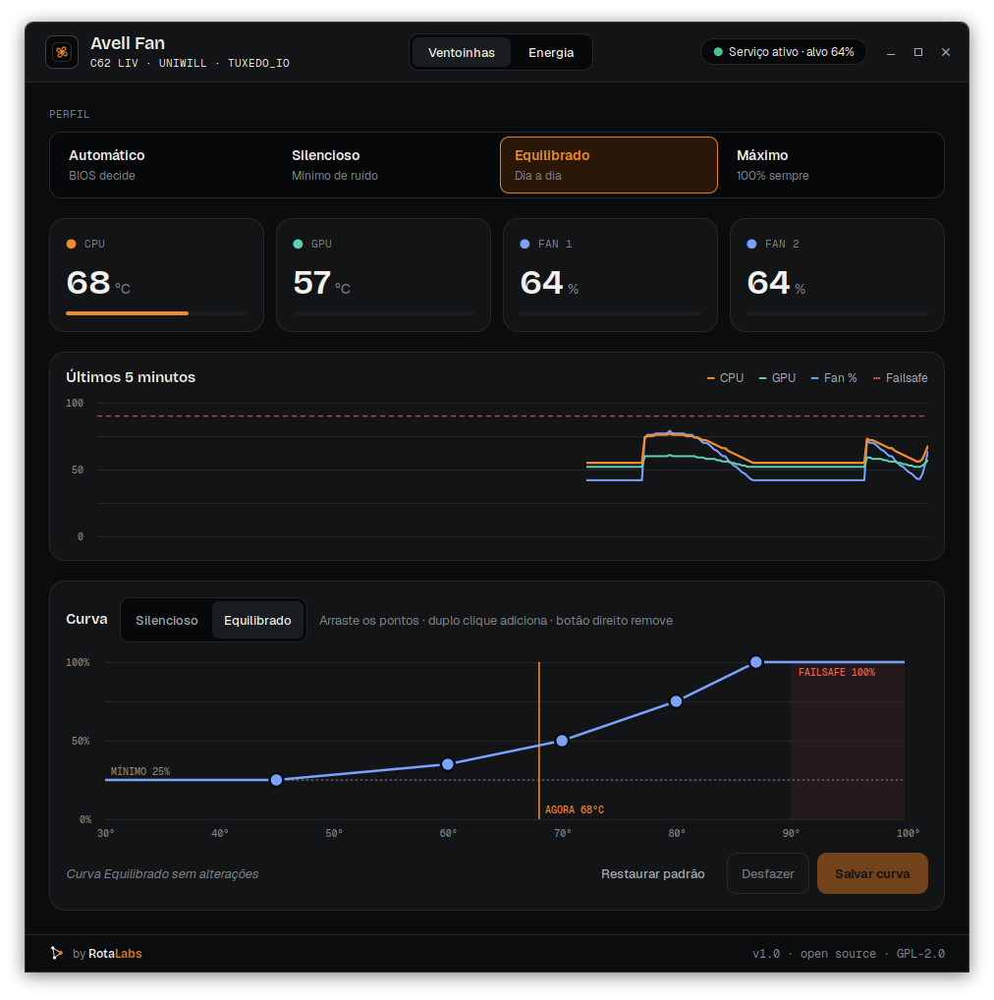
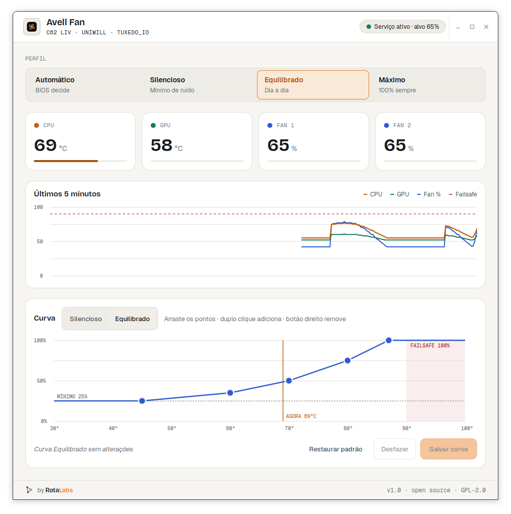

# Temas: como personalizar a interface

A aparência do Avell Fan vem inteira de um arquivo JSON: cores, fontes e raios dos cantos. O código não tem nenhuma cor fixa. O tema padrão é o **RotaLabs DS v2**, o design system da [RotaLabs](https://rotalabs.co), com os mesmos tokens `--ds-*` do site.

| Escuro (padrão) | Claro |
|---|---|
|  |  |

## Temas incluídos

| Arquivo | Descrição |
|---|---|
| [`temas/rotalabs-escuro.json`](../temas/rotalabs-escuro.json) | Padrão. Fundo grafite, destaque laranja. |
| [`temas/rotalabs-claro.json`](../temas/rotalabs-claro.json) | Variação "Clean" do DS, com contraste AA no fundo claro. |
| [`temas/tema.schema.json`](../temas/tema.schema.json) | JSON Schema: autocompletar e validação no editor. |

## Trocar de tema

```bash
avell-fan-gui --tema rotalabs-claro            # só nesta execução
avell-fan-gui --tema ~/meus-temas/roxo.json    # qualquer arquivo
```

Para deixar fixo, crie `~/.config/avell-fan/tema.json`. Ele vale para a janela e para a bandeja.

```bash
mkdir -p ~/.config/avell-fan
echo '{ "base": "rotalabs-claro" }' > ~/.config/avell-fan/tema.json
```

A interface procura o tema nesta ordem: `--tema`, depois `~/.config/avell-fan/tema.json`, depois `rotalabs-escuro`. Se o tema tiver erro, o programa avisa no terminal e volta para o padrão: a janela nunca deixa de abrir.

## Criar o seu

Um tema só precisa ter **o que muda**. Sem `base`, ele herda do `rotalabs-escuro`:

```json
{
  "$schema": "https://raw.githubusercontent.com/rotalabsco/avell-fan/main/temas/tema.schema.json",
  "nome": "Roxo",
  "cores": {
    "orange": "#7c3aed",
    "accent": "#a78bfa",
    "accent-soft": "#1e1530",
    "cpu": "#a78bfa"
  },
  "raios": { "sm": 2, "md": 4, "lg": 4 }
}
```

Com `"base": "rotalabs-claro"`, ele herda do claro. A herança pode encadear, por exemplo um tema que herda de outro tema seu.

## Tokens

### Cores

Todas no formato `#rrggbb`. Os nomes seguem o RotaLabs DS.

| Token | Onde aparece | Escuro | Claro |
|---|---|---|---|
| `bg` | fundo da janela | `#0b0c0d` | `#f6f5f2` |
| `raised` | cards, cabeçalho | `#121416` | `#ffffff` |
| `sunken` | seletores, pílulas | `#07080a` | `#eeece7` |
| `hover` | hover, trilho das barras | `#1a1d20` | `#f0eee9` |
| `line` | bordas, grades | `#23272b` | `#e2dfd8` |
| `line-strong` | bordas de ênfase, botão secundário | `#3a4248` | `#c9c5bc` |
| `ink` | texto principal | `#f2f1ee` | `#15181a` |
| `ink-2` | texto secundário | `#a9aeb2` | `#4a5157` |
| `ink-3` | rótulos, eixos | `#80878c` | `#656c72` |
| `orange` | botão primário, borda do perfil ativo | `#e77c22` | `#e77c22` |
| `accent` | texto do perfil ativo | `#f28a2e` | `#a9520a` |
| `accent-hover` | reservado (links) | `#ff9a42` | `#8f4508` |
| `accent-soft` | fundo do perfil ativo | `#2a1708` | `#fbe9d8` |
| `on-accent` | texto sobre o botão primário | `#0b0c0d` | `#0b0c0d` |
| `cpu` | linha, ponto, barra e "agora" | `#f28a2e` | `#c2610f` |
| `gpu` | linha, ponto e barra da GPU | `#5fd0b0` | `#137a5f` |
| `fan` | linha do fan, curva do editor | `#7aa2ff` | `#2f5bd3` |
| `info` | aviso informativo | `#7aa2ff` | `#2f5bd3` |
| `success` | serviço ativo | `#4cc38a` | `#17804f` |
| `warning` / `-soft` / `-line` | serviço parado | `#f2b441` | `#8a5a00` |
| `danger` / `-soft` / `-line` | failsafe, erros | `#f0655a` | `#b4261b` |
| `mark-ink` | nós do símbolo RotaLabs | `#f2f1ee` | `#2c3236` |

### Fontes

| Token | Uso | Padrão |
|---|---|---|
| `titulo` | títulos, números grandes | Bricolage Grotesque |
| `texto` | texto, botões | Geist |
| `mono` | rótulos técnicos, eixos | Geist Mono |

As três fontes padrão vêm em `fonts/` (licença OFL) e são carregadas só pelo app, sem instalar nada no sistema. Para usar outra fonte, ela precisa estar instalada: confira o nome exato com `fc-list : family`.

### Raios

| Token | Uso | Padrão |
|---|---|---|
| `sm` | itens de menu, abas | 6 |
| `md` | botões, avisos | 10 |
| `lg` | cards, seletor de perfil | 16 |

## Dicas

- **Contraste:** mantenha `ink`, `ink-2` e `ink-3` com pelo menos 4,5:1 sobre `bg` e `raised` (WCAG AA). O tema claro escurece o laranja de texto (`accent: #a9520a`) exatamente por isso.
- **Gráficos:** `cpu`, `gpu` e `fan` devem diferir em claridade, não só em tom, para quem tem daltonismo distinguir as linhas.
- **Marca:** o "Labs" do rodapé e o nó laranja do símbolo usam a cor da marca RotaLabs e não seguem o tema.
- **Compartilhe:** fez um tema bonito? Abra um PR adicionando o arquivo em `temas/`.
